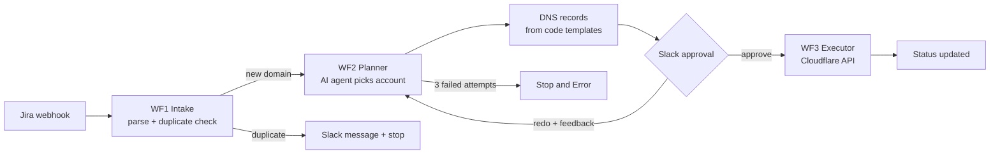

# Domain Onboarding

Three workflows that take a new domain request from Jira and set it up in Cloudflare with the right DNS records.

## How it works

**WF1 – Intake.** A Jira webhook starts the flow. An LLM extracts the domain and project from the request. The workflow checks a data table for duplicates, saves the new request with a status, and calls WF2.

**WF2 – Planner.** An AI agent finds the right Cloudflare account for the domain. It uses MySQL tools to look up similar domains and DNS provider accounts, and Cloudflare API tools to list accounts and zones. The prompt tells it not to guess: if confidence is low, it must say what data is missing. The output goes through a structured output parser with auto-fixing, so the next steps always get valid JSON.

DNS records are generated by a JavaScript resolver from per-project templates, not by the AI.

An engineer approves the plan in Slack with a form. If they choose "redo", their feedback goes back into the agent's prompt for the next attempt. After 3 failed attempts the workflow stops with an error.

**WF3 – Executor.** Creates the zone with a direct call to the Cloudflare API and updates the request status.

## Files

- `wf1-intake.json`
- `wf2-planner.json`
- `wf3-executor.json`
