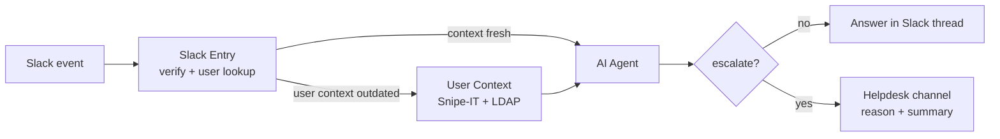

# AI Helpdesk Bot

An L1 support agent in Slack. Employees ask questions in Slack, and the agent answers using company knowledge and context about the user. It reduced L1 support workload by about 40%.

## How it works

**Slack Entry.** Receives Slack events, answers the webhook quickly, gets user info from Slack, and checks a cache table. If the user's context is outdated, it calls User Context; otherwise it goes straight to the agent.

**User Context.** Gets the user's devices from Snipe-IT and their groups from LDAP, normalizes the data in JavaScript, and saves it to data tables.

**AI Agent.** If the user attached a screenshot, Gemini analyzes the image first. The agent has conversation memory, data table tools with user context, an HTTP tool for the knowledge base, and a sub-agent tool for search. It returns structured output with an `escalate` flag, a reason, and a short conversation summary.

When the agent can't help, the request goes to the helpdesk channel with the summary, so the engineer doesn't need to ask the user again. Every step is logged in the Slack thread.

## Files

- `main-slack-entry.json`
- `user-context-sync.json`
- `ai-agent.json`
