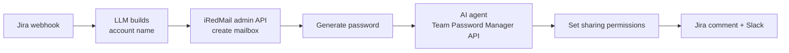

# Mailbox Provisioning

Creates a service mailbox from a Jira request and stores its password in Team Password Manager.

## How it works

1. A Jira webhook starts the flow. An LLM turns the request into a normalized account name (for example `service.project`) using strict naming rules.
2. The workflow logs in to the mail server admin panel, keeps the session cookie, and creates the mailbox.
3. A JavaScript node generates a strong password.
4. An AI agent with Team Password Manager API tools finds the right project and users, creates the password entry, and never creates an entry without the required data.
5. Sharing permissions are updated, and the result is posted to Jira and Slack.

## Files

- `mailbox-provisioning.json`
