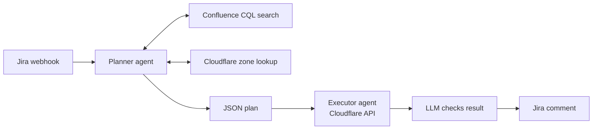

# Cloudflare DNS Agent

An earlier, two-agent version of DNS automation. A planner agent decides what to create, and an executor agent creates it.

## How it works

**Planner.** Reads the task, searches Confluence for internal DNS standards (record types, TTL, proxy settings), gets the zone ID from Cloudflare, validates the records, and returns one strict JSON plan with its assumptions.

**Executor.** Creates the records through the Cloudflare API.

**Check.** An LLM reads the API results and returns a single status line, which is posted as a Jira comment.

The later [Domain Onboarding](../01-domain-onboarding) project replaced this design: records are generated by code templates, and an engineer approves changes in Slack.

## Files

- `cloudflare-dns-agent.json`
