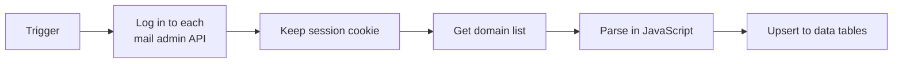

# Mail Server Domain Inventory

Collects all domains from 8 mail servers into n8n data tables, so there is one up-to-date list of domains.

## How it works

For each mail server, the workflow logs in to the admin API, keeps the session cookie, and requests the domain list. JavaScript nodes parse different response formats into one item per domain, and the results are upserted into data tables. Other workflows use this table as a source of truth.

## Files

- `mail-domain-inventory.json`
