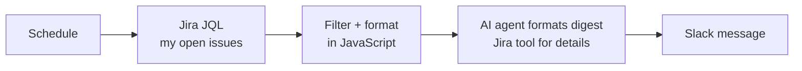

# Jira AI Digest

A scheduled summary of my open Jira tasks, sent to Slack.

## How it works

On a schedule, the workflow gets my open issues with JQL, skips service tasks, and builds a text block with deadlines, estimates, and comments. An AI agent formats it into a readable digest and can call a Jira tool when it needs more details. The result is sent to Slack.

## Files

- `jira-ai-digest.json`
